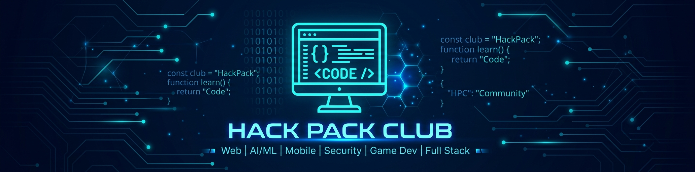

<!-- Banner -->
<p align="center">
  
</p>

<!-- Animated Typing -->
<p align="center">
  <a href="https://github.com/HackPackClub">
    
  </a>
</p>

<!-- Social Badges -->
<p align="center">
  <a href="https://github.com/HackPackClub?tab=followers">
    
  </a>
  &nbsp;
  <a href="https://github.com/HackPackClub?tab=repositories">
    
  </a>
  &nbsp;
  
</p>

<!-- Divider -->


##  **About Us**

```yaml
Name: HackPack Club
Type: Student Coding Community
Mission: Empowering students to build, learn & innovate through code
Founded: 2026

motto: "Code Together, Grow Together ⚡"

domains:
  - 🌐 Web Development
  - 🤖 Artificial Intelligence & Machine Learning
  - 📱 Mobile App Development
  - 🛡️ Cybersecurity & Ethical Hacking
  - 🎮 Game Development
  - ⚡ Full Stack Engineering

currently_building: "The next generation of tech leaders"
open_for: "Collaborations, Projects & New Members!"
```


## 🛠️ **Tech Stack & Tools**

<p align="center">

### 🌐 Frontend
<p align="center">
  
</p>

### ⚙️ Backend
<p align="center">
  
</p>

### 📱 Mobile & Cross-Platform
<p align="center">
  
</p>

### 🤖 AI / ML & Data Science
<p align="center">
  
</p>

### 🎮 Game Development
<p align="center">
  
</p>

### 🛡️ Security & DevOps
<p align="center">
  
</p>

### 🗄️ Databases
<p align="center">
  
</p>

### 🧰 Tools & IDEs
<p align="center">
  
</p>

</p>


## 📊 **GitHub Analytics**

<p align="center">
  <a href="https://github.com/HackPackClub">
    
  </a>
  &nbsp;&nbsp;
  <a href="https://github.com/HackPackClub">
    
  </a>
</p>

<!-- Streak Stats -->
<p align="center">
  <a href="https://github.com/HackPackClub">
    
  </a>
</p>

<!-- Activity Graph -->
<p align="center">
  <a href="https://github.com/HackPackClub">
    
  </a>
</p>

<!-- 3D Contribution Calendar -->
<p align="center">
  <a href="https://github.com/HackPackClub">
    
  </a>
</p>


## 🏆 **GitHub Trophies**

<p align="center">
  <a href="https://github.com/HackPackClub">
    
  </a>
</p>

<!-- Fallback: GitHub Stats Summary -->
<p align="center">
  <a href="https://github.com/HackPackClub">
    
  </a>
</p>


## 🐍 **Contribution Snake**

<p align="center">
  <picture>
    <source media="(prefers-color-scheme: dark)" srcset="https://raw.githubusercontent.com/HackPackClub/HackPackClub/output/github-snake-dark.svg" />
    <source media="(prefers-color-scheme: light)" srcset="https://raw.githubusercontent.com/HackPackClub/HackPackClub/output/github-snake.svg" />
    
  </picture>
</p>

> 💡 *Run the **Generate Snake Animation** workflow from the [Actions tab](https://github.com/HackPackClub/HackPackClub/actions) to generate this animation!*


## 🤝 **Join the Pack!**

<p align="center">
   <b>We love connecting with fellow developers!</b>
</p>

<p align="center">
  Whether you're a beginner or a pro — there's a place for you at <b>HackPack Club</b>.<br/>
  Let's build something amazing together! ⚡
</p>

<br/>

<!-- Connect Section -->
<p align="center">
  <a href="https://github.com/HackPackClub">
    
  </a>
  <!-- Add your social links below! -->
  <!--
  <a href="https://discord.gg/YOUR_INVITE">
    
  </a>
  <a href="https://twitter.com/HackPackClub">
    
  </a>
  <a href="https://www.linkedin.com/company/hackpackclub">
    
  </a>
  <a href="mailto:hackpackclub@gmail.com">
    
  </a>
  -->
</p>

<br/>

<!-- Random Dev Quote -->
<p align="center">
  
</p>

<br/>

<!-- Footer -->
<p align="center">
  
</p>

<p align="center">
  <b>⭐ Star our repos if you find them useful! ⭐</b><br/>
  <sub>Made with 💙 by HackPack Club</sub>
</p>
