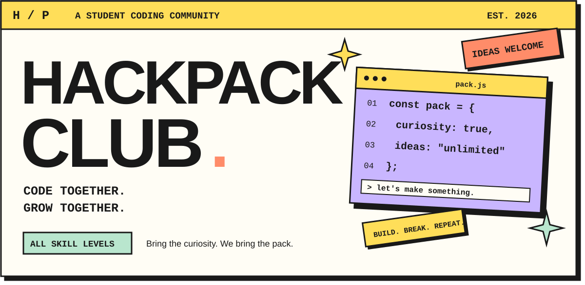
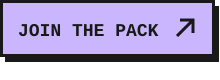
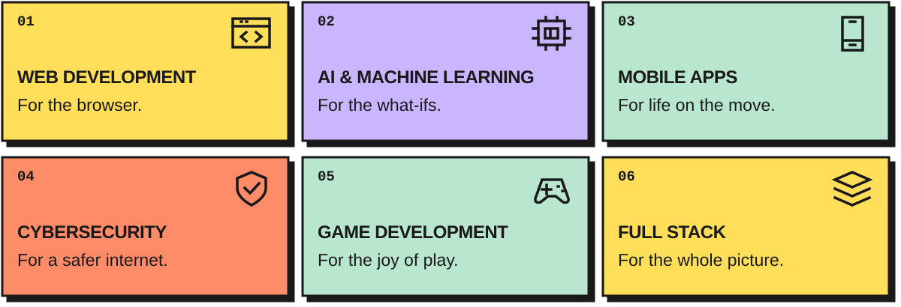
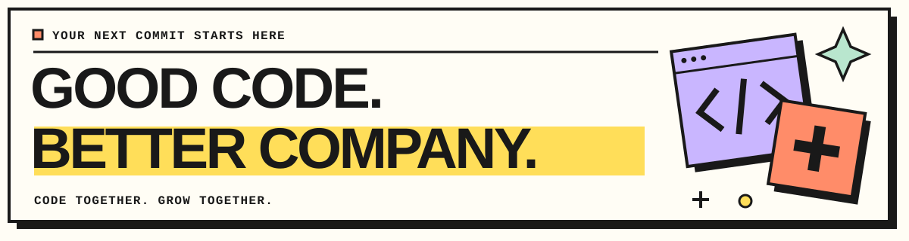

<picture>
  <source media="(prefers-reduced-motion: reduce) and (max-width: 640px)" srcset="assets/hackpack-hero-mobile.svg" />
  <source media="(prefers-reduced-motion: reduce)" srcset="assets/hackpack-hero.svg" />
  <source media="(prefers-reduced-motion: no-preference) and (max-width: 640px)" srcset="assets/hackpack-opening-mobile.gif" type="image/gif" />
  <source media="(prefers-reduced-motion: no-preference)" srcset="assets/hackpack-opening.gif" type="image/gif" />
  <source media="(max-width: 640px)" srcset="assets/hackpack-hero-mobile.svg" />
  
</picture>

 
 

 &nbsp; 

 
 

**Curious minds. Bold ideas. Things that actually work.**

We're a student coding community turning “what if?” into “we built it.” Learn something new, find your people, and make your next idea real.

 

[THE CLUB](#the-club) &nbsp; / &nbsp; [OUR PLAYGROUND](#our-playground) &nbsp; / &nbsp; [THE TOOLBOX](#the-toolbox) &nbsp; / &nbsp; [JOIN US](#join-the-pack)

 

## 01 / Small commits. Big possibilities.

HackPack Club brings students together to **build, learn, and innovate through code**. We're here for the first-time experimenters, the serial side-project starters, and everyone in between.

> **THE HACKPACK WAY**
>
> **Build together.** Turn ideas into projects with fellow developers.
>
> **Stay curious.** Explore a new tool, share what you learn, and keep experimenting.
>
> **Grow together.** Ask questions, contribute, and help someone take their next step.

**Student coding community** &nbsp; · &nbsp; **Established 2026** &nbsp; · &nbsp; **Open to collaborators & new members**

 

## 02 / Pick your playground.

One pack. Plenty of ways to make something cool.

<picture>
  <source media="(max-width: 640px)" srcset="assets/hackpack-playgrounds-mobile.svg" />
  
</picture>

<b>Explore the focus areas</b>

- **Web Development** — Interfaces, websites, and experiences for the browser.
- **AI & Machine Learning** — Models, experiments, and ideas powered by data.
- **Mobile App Development** — Apps that go wherever you do.
- **Cybersecurity & Ethical Hacking** — Understand systems and learn to defend them.
- **Game Development** — Playable worlds, mechanics, and creative experiments.
- **Full Stack Engineering** — Connect the interface, server, and database.

 

## 03 / Ideas first. Tools second.

Different projects call for different tools. Here's our playground under the hood.

**THE FRONT END** &nbsp; / &nbsp; Make it look good. Make it feel right.

<picture>
  <source media="(max-width: 640px)" srcset="https://skillicons.dev/icons?i=html%2Ccss%2Cjs%2Cts%2Creact%2Cnextjs%2Cvue%2Cangular%2Ctailwind%2Cbootstrap%2Csass&amp;theme=light&amp;perline=6" />
  
</picture>

**THE ENGINE ROOM** &nbsp; / &nbsp; Give the idea some power.

<picture>
  <source media="(max-width: 640px)" srcset="https://skillicons.dev/icons?i=nodejs%2Cexpress%2Cpython%2Cdjango%2Cflask%2Cjava%2Cspring%2Cgo%2Crust%2Cphp&amp;theme=light&amp;perline=6" />
  
</picture>

**BEYOND THE BROWSER** &nbsp; / &nbsp; Build outside the box.

<picture>
  <source media="(max-width: 640px)" srcset="https://skillicons.dev/icons?i=flutter%2Cdart%2Ckotlin%2Cswift%2Ctensorflow%2Cpytorch%2Copencv%2Cunity%2Cunreal%2Cgodot%2Ccs%2Ccpp&amp;theme=light&amp;perline=6" />
  
</picture>

<b>More from the toolbox ↗</b>

 

**Security, cloud & DevOps**

<picture>
  <source media="(max-width: 640px)" srcset="https://skillicons.dev/icons?i=linux%2Cbash%2Cdocker%2Ckubernetes%2Caws%2Cgcp%2Cazure%2Cgit%2Cgithub%2Cgithubactions&amp;theme=light&amp;perline=6" />
  
</picture>

**Databases**

<picture>
  <source media="(max-width: 640px)" srcset="https://skillicons.dev/icons?i=mongodb%2Cmysql%2Cpostgres%2Credis%2Cfirebase%2Csupabase&amp;theme=light&amp;perline=6" />
  
</picture>

**The everyday essentials**

<picture>
  <source media="(max-width: 640px)" srcset="https://skillicons.dev/icons?i=vscode%2Cidea%2Cfigma%2Cpostman%2Cnotion%2Cobsidian&amp;theme=light&amp;perline=6" />
  
</picture>

 

<b>📈 Behind the commits / GitHub activity</b>

 

[Explore our repositories and recent work →](https://github.com/HackPackClub?tab=repositories)

 

## 04 / There's room in the pack.

Your first line of code or your next big project — **you're welcome here.**

1. **Find your spark.** [Explore our repositories](https://github.com/HackPackClub?tab=repositories) and pick something that interests you.
2. **Get involved.** Open an issue with an idea, ask a question, or send a pull request.
3. **Keep building.** [Follow HackPack Club](https://github.com/HackPackClub) to see what comes next.

 

 

Made by **HackPack Club** &nbsp; / &nbsp; Built to be built together. Found something useful? Give the project a star. **✦**

